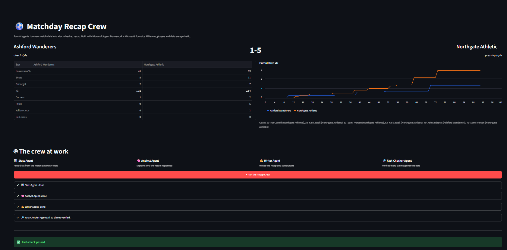
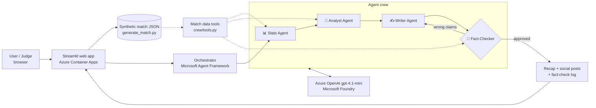

# ⚽ Matchday Recap Crew

**Four AI agents that turn raw football match data into a fact-checked match report and social posts in under a minute.**

Built for the *Inside the Game: Developer Hackathon* (Microsoft × Premier League). Category: **Best Multi-Agent System**.

🔗 **Live demo:** https://matchday-recap-crew.jollypebble-71ea79f7.eastus2.azurecontainerapps.io
🎬 **Demo video (under 2 min):** _add your YouTube link here_

> The first visit may take ~30 seconds while the app wakes up (it scales to zero when idle).



---

## The problem

Club media teams publish recaps, stat cards and social posts minutes after every final whistle. Done by hand, that is slow. Done with a single AI prompt, it is fast but risky: language models make up scorers, minutes and stats, and one wrong fact in a published recap damages trust.

## The solution

Instead of one model doing everything, **Matchday Recap Crew** splits the job across four specialist agents. Each one has its own instructions and its own **tools that read the match data directly**. The final agent is a **fact-checker that verifies every claim against the data and sends the draft back for revision** until it passes.

| Agent | Job | Tools it can call |
|---|---|---|
| 📊 **Stats Agent** | Builds a fact sheet: score, goals, possession, shots, xG, cards, half-by-half comparison | `get_match_overview`, `get_goals`, `get_key_moments`, `get_period_stats` |
| 🧠 **Analyst Agent** | Explains *why* the result happened: momentum swings, finishing vs xG, cards, substitutions, playing styles | `get_period_stats`, `get_key_moments` |
| ✍️ **Writer Agent** | Writes a headline, a 200–250 word recap and three social posts (home fans, away fans, neutral) | none, so it can only use what the other agents verified |
| 🔎 **Fact-Checker Agent** | Classifies every claim as *correct*, *wrong* or *opinion* and sends wrong claims back to the Writer (up to 2 revision rounds) | `get_match_overview`, `get_goals`, `get_key_moments`, `get_events_at_minute`, `get_player_events`, `get_period_stats` |

**Demo mode:** a toggle in the app makes the Writer deliberately get one fact wrong in its first draft, so you can watch the Fact-Checker catch it, send it back and approve the corrected version. It is labelled as a demo in the UI.

## Architecture



## Microsoft technologies used

- **Microsoft Foundry**: hosts the `gpt-4.1-mini` model deployment that powers all four agents
- **Microsoft Agent Framework (Python)**: agent definitions, tool calling and the multi-agent loop
- **Azure Container Apps**: serverless hosting with scale-to-zero, container built in the cloud from the Dockerfile (Azure Container Registry)
- **Container Apps secrets**: the API key is stored as an encrypted secret, never in code
- **GitHub**: source control and public repository

## Synthetic data and IP compliance

All teams, players, leagues and match events are **invented** by [`data/generate_match.py`](data/generate_match.py). No real match footage, Premier League data, club names, logos or trademarks are used. The generator produces realistic matches: team playing styles (possession, counter, pressing, direct), momentum swings, shots with xG values, goals, assists, cards, red-card effects and substitutions.

```bash
python data/generate_match.py --seed 1 --count 3
```

## Run it locally

Requirements: Python 3.10+ and an Azure OpenAI / Foundry model deployment.

```bash
git clone https://github.com/Danielctrl-ai/matchday-recap-crew.git
cd matchday-recap-crew
python -m venv .venv
# Windows: .venv\Scripts\Activate.ps1    macOS/Linux: source .venv/bin/activate
pip install -r requirements.txt
cp .env.example .env    # then fill in your endpoint, key and deployment name
python data/generate_match.py --seed 1 --count 3
streamlit run app.py     # web app at http://localhost:8501
python run_crew.py       # or run the crew in the terminal
```

## Deploy to Azure Container Apps

```bash
az containerapp up --name matchday-recap-crew --resource-group matchday-rg \
  --location eastus2 --source . --ingress external --target-port 8501

az containerapp secret set -n matchday-recap-crew -g matchday-rg --secrets aoai-key="<KEY>"
az containerapp update -n matchday-recap-crew -g matchday-rg \
  --set-env-vars AZURE_OPENAI_API_KEY=secretref:aoai-key \
  AZURE_OPENAI_ENDPOINT=https://<resource>.openai.azure.com/ AZURE_OPENAI_DEPLOYMENT=gpt-4.1-mini \
  --min-replicas 0 --max-replicas 1
```

## Project structure

```
app.py                 Streamlit web app (live agent feed, stats, xG chart)
run_crew.py            Command-line runner
crew/agents.py         The four agents and the fact-check revision loop
crew/tools.py          Match-data tools the agents call
data/generate_match.py Synthetic match generator
Dockerfile             Container image for Azure Container Apps
```

## Responsible AI

- **Grounded outputs:** agents get facts from tool calls on the data, not from model memory.
- **Verification loop:** every factual claim is checked before the content is shown as approved. If issues remain after two revisions, the app warns the user instead of claiming the content is verified.
- **Human in control:** the output is a draft for a media team to review, with a full fact-check log.
- **Cost and abuse guards:** per-session run limit, model rate limit, a single max replica and an Azure budget alert.

## Real-world impact

The same crew works for any league with event data: club media teams, grassroots and women's leagues without large content teams, student newspapers, and accessibility (plain-language and translated recaps are a short step away). Swap the synthetic generator for a licensed event feed and the agents work unchanged.

## License

MIT
